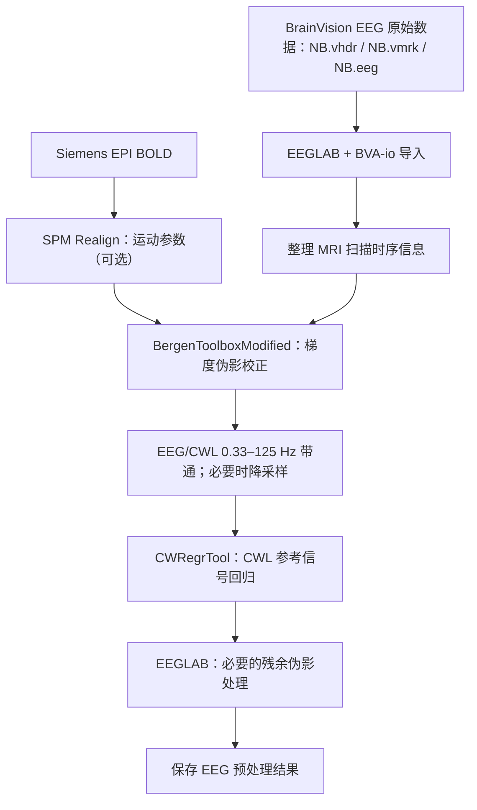

# EEG–fMRI 实验后 EEG 预处理流程（CWL 版本）

**版本：** v2.2（2026-10-23，基于 v2.1 审计修订）  
**适用数据：** 同步 EEG–fMRI 实验结束后的连续 EEG，包含已记录的碳线环（CWL）参考通道；对应的 MRI 为 Siemens 常规 EPI BOLD。  
**处理平台：** Windows / MATLAB / EEGLAB。  
**终点：** 生成经 MRI 梯度伪影校正、CWL 回归和必要的常规伪影处理后的连续 EEG `.set` 数据集；不包含 EEG 特征提取、EEG–BOLD 分析、实时反馈。  
**本版调整（v2.2）：** ① CWL 回归前降采样到 500 Hz 由“可选”改为“强烈建议”（原 5000 Hz 下回归量约 1266 个/窗，论文为约 126 个）；② 已按 Bergen fork 源码确认 CWL 通道会被梯度校正；③ 补充 CWRegrTool 对记录首尾的未校正区段说明及命令行写法；④ 修正“球搏伪影”术语；⑤ 补充 EEG/CWL 须使用同一滤波器及回归前不得删段。
**基于 Bergen fork 源码的核对（v2.2）：** 已确认 Bergen 会校正全部通道（含 CWL）、校正范围外数据不处理、边界处可能残留 NaN、第 5/6 步可一次完成 0.33–125 Hz 滤波与 500 Hz 降采样、`rp_info` 的 dummy 补零规则。
**v2.1 调整：** 采用 EEGLAB 官方 GitHub 仓库地址；BergenToolboxModified 仅保留校正目的、所需信息和结果，不预设具体 GUI 操作顺序或参数填写方法。延续精简版要求：不设独立数据 check/QC 流程，不执行坏通道插值或重参考。


---

## 1. 处理流程总览



**处理顺序：** `BrainVision 导入 → 获取 MRI 时序和可选头动参数 → Bergen → EEG/CWL 滤波 → CWRegrTool → 必要的残余伪影处理 → 保存`。

不同扫描 run 分开执行上述流程；不要将扫描中断或相互独立的 run 当作一个连续 MRI 伪影周期来处理。

## 2. 需要的软件

| 软件/插件 | 在流程中的用途 | 链接 |
|---|---|---|
| MATLAB | 运行 EEGLAB、插件与脚本 | <https://www.mathworks.com/products/matlab.html> |
| EEGLAB | EEG 数据导入、滤波、ICA、保存 | <https://github.com/sccn/eeglab> |
| **BVA-io**（BrainVision 导入插件） | 直接读取 `.vhdr` + `.vmrk` + `.eeg` | <https://github.com/sccn/bva-io> |
| SPM | 从 EPI BOLD 提取运动参数；仅运动感知 Bergen 方式需要 | <https://www.fil.ion.ucl.ac.uk/spm/> |
| BergenToolboxModified | 去除 MRI 梯度伪影 | <https://github.com/albertleemon/BergenToolboxModified> |
| CWRegrTool | 利用 CWL 信号回归去除 BCG、振动及运动相关伪影 | <https://github.com/jnvandermeer/CWRegrTool> |
| ICLabel（可选） | 辅助分类残余眼动或肌电 ICA 成分 | <https://eeglab.org/plugins/ICLabel/> |

**说明：** EEGLAB 官方 GitHub 项目为 <https://github.com/sccn/eeglab>。已提供的 `NB.vhdr`、`NB.vmrk`、`NB.eeg` 是 BrainVision 三文件格式，可直接通过 BVA-io 导入，**本流程不需要 Bittium NeurOne EEGLAB Reader**。这种文件格式本身并不能单独证明记录时使用的放大器型号。

将 `BergenToolboxModified` 和 `CWRegrTool` 的完整文件夹分别放在 `eeglab/plugins/` 目录下，重启 EEGLAB。

---

## 3. Step 1：导入 BrainVision 原始 EEG

**软件：** MATLAB + EEGLAB + BVA-io  
**输入：** `NB.vhdr`、`NB.vmrk`、`NB.eeg`（三个文件放在同一个目录）  
**输出：** `01_imported_raw.set`

本次上传的 `NB` 文件头记录了以下信息：

| 项目 | 文件中记录的值 |
|---|---|
| 通道数 | 72 |
| 采样率 | 5000 Hz |
| 采样间隔 | 200 μs |
| 数据格式 | BrainVision，INT_16，MULTIPLEXED |
| ECG | 通道 32 |
| CWL | 通道 67–72，依次为 `CW6`、`CW5`、`CW4`、`CW3`、`CW2`、`CW1` |
| 65、66 通道 | 名称分别为 `65`、`66`；本 SOP 不将其作为 EEG 或 CWL 目标通道 |

操作：

1. 保持 `NB.vhdr`、`NB.vmrk`、`NB.eeg` 文件名及相互引用不变。
2. 启动 MATLAB 和 EEGLAB，在扩展管理中安装 BVA-io（如果尚未安装）。
3. 通过 EEGLAB 的 BrainVision 导入菜单选择 `NB.vhdr`，或者使用以下代码。
4. 将导入数据另存为 EEGLAB `.set` 格式。

```matlab
% 按实际存储位置修改
input_dir = 'D:\EEG_data\NB';
output_dir = fullfile(input_dir, 'preprocessed');
if ~exist(output_dir, 'dir'), mkdir(output_dir); end

eeglab;
EEG = pop_loadbv(input_dir, 'NB.vhdr');
EEG = eeg_checkset(EEG);   % EEGLAB 数据结构整理，不是独立 QC 流程

EEG = pop_saveset(EEG, ...
    'filename', '01_imported_raw.set', ...
    'filepath', output_dir);
```

后续处理始终使用新生成的 `.set` 数据；原始的三个 BrainVision 文件不作覆盖或修改。

## 4. Step 2：准备 MRI 时序及可选头动参数

**软件：** EEGLAB / MATLAB；如使用运动感知模板则增加 SPM  
**输入：** 导入后的 EEG 事件、相应 run 的 EPI BOLD 图像和扫描参数  
**输出：** Bergen 使用的 volume 起始事件，以及可选的 `rp_*.txt`

### 4.1 MRI volume 起始事件

`NB.vmrk` 包含 `Response,R128` 事件，数量为 **167**；相邻 `R128` 的样本间隔为 **9000 个样本**，在 5000 Hz 下为 **1.8 秒**。因此，`R128` 是这份数据中拟用于 Bergen 的 **volume onset 候选事件**。

只有在其与实际 Siemens EPI BOLD run 的 TR、volume 数及 dummy volume 关系一致时，才将 `R128` 作为 Bergen 的 volume marker。`SyncStatus,Sync On` 属于时钟同步状态标记，不用于替代逐 volume 的扫描起始标记。原有的 `Stimulus` 事件应保留。

### 4.2 fMRI 头动参数（采用 Bergen 运动感知模式时）

在 SPM 中运行：

`SPM → Batch → Spatial → Realign → Estimate`

为对应的 EPI BOLD run 生成 `rp_*.txt`。该文件一般含每个 MRI volume 的三个平移和三个旋转参数，需要与 Bergen 处理的扫描起始事件在 run 和 volume 顺序上一致。

如果没有对应的头动参数，可改用 Bergen 的 `Moving Average` 模式；这与论文中使用的运动感知方法不同。

## 5. Step 3：BergenToolboxModified 进行 MRI 梯度伪影校正

**软件：** EEGLAB + BergenToolboxModified  
**输入：** `01_imported_raw.set`；与相应 EPI BOLD run 对应的 MRI 扫描时序信息；必要时使用头动参数  
**输出：** `02_gradient_corrected.set`

MRI 的快速梯度切换会在同步记录的 EEG 中产生很强的周期性伪影。**本步骤使用 BergenToolboxModified，目的仅是去除 MRI 梯度伪影**；后续心搏相关和运动相关伪影由 CWL 回归处理。

本流程使用的 Bergen 插件是你 fork 的 `albertleemon/BergenToolboxModified`（已按其源码核对，见下）。菜单：`Tools → Bergen EEG-fMRI Toolbox → Remove fMRI gradient artifacts`，GUI 共 6 步。**该插件的 `Apply` 会直接覆盖 EEGLAB 当前数据集**，所以必须先保存好 `01_imported_raw.set`。

**已按源码确认的行为：**

1. `CorrectionMatrix.m` 对 **所有通道**（`1..EEG.nbchan`）逐一校正，因此 `CW1`–`CW6`、ECG 以及 65、66 通道都会得到与 EEG 相同的梯度伪影校正。此前“Bergen 是否处理 CWL 通道”的疑问已解决，无需另外处理。
2. 只有“第一个 volume 标记 + onset”到“最后一个标记 + offset”之间的样本会被校正；**这个范围之前和之后的数据保持未校正**（仍含梯度伪影）。如果最后一个 artifact 超出记录末尾，函数会报 `Memory index error` 并**不修改数据**，此时必须先把记录末尾多余部分剪掉。后续 CWL 回归前应把未校正的首尾剪掉。
3. 模板由逐通道经 1 Hz 高通后的副本生成，并自动排除与其他模板相关性很差的 artifact；检测到削波（clipping）的点会被置 NaN 后用线性插值替代。已标注的信息存放在 `EEG.annotations`（`nansamples`、`badcorrelation`）。**位于校正范围首尾边界的 NaN 不会被插值**，可能残留。进入 CWRegrTool 前必须确认数据中没有 NaN（见 Step 5），否则 `pinv` 会报错。
4. `m_rp_info.m` 的 `threshold` 单位是 mm，是相邻 volume 间平移的**欧氏位移**（对应论文式 3）；旋转权重被设为 0，不参与。`k` 为模板用的 artifact 数。volume 数以 GUI 中检测到的标记数为准：如果 `rp_*.txt` 行数比标记数少，则视为前面被去掉了 dummy scan，在**开头**补零；如果更多，则截断并给出警告。所以 SPM Realign 必须对应同一 run 的**后 N 个** volume，且 `R128` 数量 = dummy 数 + 参与 Realign 的 volume 数。
5. 硬编码的“CW 1…CW 8 低通 70 Hz”与“ECG 低通 100 Hz”逻辑在这份代码中已被置空（`do_additional_channels=[]`、`check_ecg=[]`），不会生效。

**GUI 六步（参数以实际数据为准，不预设数值）：**

| 步骤 | 内容 | 本数据的要点 |
|---|---|---|
| 1/6 | volume 起点检测 | 选 `Use markers`，标记类型选 `R128`，并选“一个标记对应一个 artifact 起点”（marker per onset）。核对检测到的数量与相邻间隔（9000 样本 = 1.8 s）。 |
| 2/6 | Artifact 时长（onset / offset） | 用 GUI 预览，使范围覆盖整个 TR 内的梯度伪影；offset 不得使范围超过记录末尾。 |
| 3/6 | 基线校正 | 按插件预览选择；论文未规定。 |
| 4/6 | 校正矩阵 | 有头动参数：选 `rp_info`（`rp_*.txt`、threshold、k）；论文使用 k = 25，位移阈值 0.3 mm（出自论文，需与当前 TR/体素设置对照）。没有头动参数：选 moving average。 |
| 5/6 | 滤波 / 降采样 | 见 Step 4：这一步可以直接完成 0.33–125 Hz 滤波与降采样。 |
| 6/6 | 核对并 Apply | Apply 会覆盖当前数据集，之后立即另存为 `02_gradient_corrected.set`。 |

处理时遵循以下原则：

1. 在 EEGLAB 中加载 `01_imported_raw.set`，确保它是当前数据集。
2. 为插件提供 `R128` 标记；采用 `rp_info` 时提供对应的 `rp_*.txt`。
3. 梯度校正在原始 5000 Hz 数据上完成。
4. 完成后另存为 `02_gradient_corrected.set`，原始导入数据不覆盖。
5. 校正后 `EEG.annotations` 中的布尔矩阵与当时的采样率对应，**降采样后不再有效**，本流程不使用它们。

**文献参考（非本实验的预设参数）：** van der Meer 等人（2016）采用邻近 25 个 MRI 伪影片段构建模板，并结合 fMRI 头动信息决定何时重置模板缓冲区。该参数属于论文原始实现；若当前插件设置和单位尚未确认，不直接照搬。

**说明：** CWL 环路会感应到很强的梯度切换伪影，论文也是在梯度校正之后才对 EEG 与 CWL 做带通和回归。已按源码确认你的 fork 会对所有通道（包含 `CW1`–`CW6`）做校正，所以这一点已满足；若换用其他版本的 Bergen，需要重新确认。

## 6. Step 4：EEG 与 CWL 滤波及必要的降采样

**软件：** EEGLAB  
**输入：** `02_gradient_corrected.set`  
**输出：** `03_filtered.set`

van der Meer 等人（2016）在梯度校正后、CWL 回归前，对 EEG 和 CWL 信号采用 **0.33–125 Hz 带通滤波**。这是论文的具体处理配置；若后续研究要求保留 0.33 Hz 以下的慢波或 125 Hz 以上的活动，需要另行设计相应带宽。

在 EEGLAB 中可使用 `Tools → Filter the data` 设置滤波参数，或采用对应版本的 `pop_eegfiltnew()`。**EEG 与 CWL 必须保持共同的采样时间轴**；滤波设置应考虑每种通道的用途及目标频段。

**两种等价做法，二选一，不要两种都做：**

- **做法 A（在 Bergen 第 5/6 步内完成）：** 勾选滤波，低边界填 0.33、高边界填 125，并勾选重采样到 500 Hz。Bergen 的实际顺序是 `低通 → 重采样 → 高通`，全部作用于所有通道（包含 CWL），因此 EEG 与 CWL 的滤波自动一致。此时 `02_gradient_corrected.set` 已是滤波并降采样后的数据，`03_filtered.set` 可直接由它复制得到。
- **做法 B（Bergen 内不勾选）：** 先保存 `02_gradient_corrected.set`（5000 Hz），再在 EEGLAB 中按下面的要求滤波和降采样。

**EEG 与 CWL 必须使用同一滤波器（相同类型、截止频率和零相位设置），并同时作用于所有 EEG 与 CWL 通道。** 回归估计的是 CWL 到各电极的线性传递关系，两者滤波不一致会破坏这一关系。

**降采样（强烈建议，不再是可选项）：** CWRegrTool 的时间移位范围为 `floor(srate × delay)` 个样本，每个 CWL 取 `1 + 2×该值` 个延迟。当前数据为 5000 Hz，则每个 CWL 有 211 个延迟，6 个 CWL 共 **1266 个回归量**，对应每个 4 s 窗（20001 个样本）；论文使用 500 Hz，对应每个 CWL 21 个延迟，共约 **126 个回归量**（论文报告其方法在该采样率下 5 分钟、30 通道的数据约需 15 s）。5000 Hz 下运算量和内存开销大约高一个数量级以上，且回归量过多更容易过拟合、吃掉真实 EEG。因此：在 0.33–125 Hz 带通之后，用 EEGLAB `pop_resample` 将 EEG 与 CWL 一起降到 **500 Hz**（5000/500 为整数倍，自带抗混叠滤波；125 Hz 上限低于 250 Hz Nyquist）。降采样后 Bergen 的 volume 事件不再使用；其他事件的延迟由 `pop_resample` 自动换算。

最后保存 `03_filtered.set`。

## 7. Step 5：CWRegrTool 进行 CWL 回归伪影校正

**软件：** EEGLAB + CWRegrTool  
**输入：** `03_filtered.set`，包含同步采集的 CWL 通道  
**输出：** `04_cwl_corrected.set`

CWL 参考信号可反映磁场中的心搏及运动相关扰动。CWRegrTool 把 CWL 信号及其时间移位作为回归量，估计各 EEG 通道中的运动相关伪影，再减去估计出的成分。其目标包括 **BCG（心冲击伪影，ballistocardiogram）**、**氦泵（He pump）振动伪影**和头动等运动相关伪影。

在 EEGLAB 的 CW Regression Tool 界面中，选用下面的论文配置：

| 参数 | 设定 |
|---|---|
| Sampling rate（GUI 自动读取） | 应为 **500 Hz**（降采样之后） |
| Regression Method | `taperedhann` |
| Window Duration | **4 s** |
| Delay | **0.021 s（21 ms）** |
| Tapering Factor | **1** |
| Window Function | `hann` |
| CWL Reference Channels | 本数据 **67–72**（`CW6` 至 `CW1`） |
| EEG Target Channels | 真实 EEG 电极通道；不包括 ECG、CWL、未知用途的辅助通道 |

对于当前 `NB` 文件，按头文件的标签，普通 EEG 候选通道是 **1–31 与 33–64**。第 **32** 通道为 `ECG`，第 **65、66** 通道用途尚不明确，第 **67–72** 通道为 CWL，不作为普通 EEG 目标通道。实际目标通道选择应与实验记录保持一致。

**注意：** 插件可能根据 `CW.*` 形式的通道标签自动寻找 CWL；本数据名称已经是 `CW1`–`CW6`，但仍应在 GUI 中明确指定参考和目标通道。21 ms 是模型允许的时间移位范围，**不是 EEG-MRI 同步延迟**。

CWL 回归是与论文中 AAS、OBS、OBS-ICA 相比较的另一种校正路线；**不需要在本路线之后固定依次运行 AAS、OBS、OBS-ICA**，因此本流程也不需要 ECG R 波标记。

也可用命令行（无 GUI）调用，通道序号以降采样后的数据为准（通道顺序不变）：

```matlab
EEG = pop_cwregression(EEG, EEG.srate, 4, 0.021, 1, 'hann', 67:72, [1:31 33:64], 'taperedhann', 0);
```

**使用限制（按 `m_do_taperedhann.m` 代码阅读得出，未在 MATLAB 中实际运行验证）：**

0. 回归前请确认 `any(isnan(EEG.data(:)))` 为 false。Bergen 在校正范围边界处可能残留 NaN，它会使 `pinv` 失败；如有，把含 NaN 的首尾样本剪掉（用 `pop_select` 按时间范围）。同时剪掉 Bergen 未校正的记录首尾（第一个 volume 之前、最后一个 volume 之后）。
1. 该函数以“前一窗的后半 + 后一窗的前半”拼接减去的信号，只有记录中间部分被完整校正。记录**开头约半个窗长（约 2 s）以及结尾约 2–6 s 不会被减去任何信号**，即保持未校正。建议要么在 Step 6 中把这两段按 `boundary` 事件剪掉，要么在采集时在扫描前后多记录几秒。
2. 回归在连续数据上进行，**CWL 回归之前不得删除任何数据片段**（删除会破坏窗内时间连续性）；删段只放在 Step 6。
3. 回归使用 `pinv`，通道间独立拟合，不会修改 CWL 与 ECG 通道本身。

校正后另存为 `04_cwl_corrected.set`。

## 8. Step 6：必要的残余 EEG 伪影处理

**软件：** EEGLAB；必要时使用 ICA / ICLabel  
**输入：** `04_cwl_corrected.set`  
**输出：** `05_preprocessed.set`

根据后续研究任务，对仍然存在的非脑源成分进行必要处理：

1. **严重污染片段：** 对不可用的强烈瞬时运动、接触干扰或大范围污染片段进行标注或移除；若进行删除，保留 EEGLAB 的 `boundary` 事件。
2. **明显异常 EEG 通道：** 如某些 EEG 通道无法用于后续分析，可将其从目标分析数据中排除；**本 SOP 不执行坏通道插值**。
3. **工频与其他窄带干扰：** 如研究需要，可使用与目标频段相容的窄带处理方式；不将 50 Hz 陷波作为所有数据必须执行的固定步骤。
4. **残余眼动、肌电等：** 如需要，可使用 EEGLAB ICA，并结合 ICLabel、通道拓扑和时间特征选择非脑源成分。ICA 是可选的残余伪影处理，不是 CWL 回归的替代。

**本版不进行 EEG 重参考**。保留当前数据所采用的参考方式，并在后续具体分析设计中另行决定是否修改。

完成后另存为 `05_preprocessed.set`，到此结束预处理。

---

## 9. 建议文件目录

```text
subject-01/
├── original/
│   ├── NB.vhdr
│   ├── NB.vmrk
│   ├── NB.eeg
│   └── fmri_original/
├── fmri_motion/                  # 采用 Bergen 运动感知方法时
│   └── rp_run01.txt
└── eeg_preprocessing/
    ├── 01_imported_raw.set
    ├── 02_gradient_corrected.set
    ├── 03_filtered.set
    ├── 04_cwl_corrected.set
    └── 05_preprocessed.set
```

说明：

- 不同 run 分别命名，例如 `run01_01_imported_raw.set`、`run02_01_imported_raw.set`。
- EEGLAB 有时会将数据存储在独立的 `.fdt` 文件中，需与 `.set` 同时保留。
- 输出 `.set` 只用于保存每个处理阶段，不覆盖 BrainVision 原始三文件。

## 10. 参考文献与工具

1. van der Meer, J. N., et al. (2016). **Carbon-wire loop based artifact correction outperforms post-processing EEG/fMRI corrections—A validation of a real-time simultaneous EEG/fMRI correction method.** *NeuroImage*, 125, 880–894. DOI: <https://doi.org/10.1016/j.neuroimage.2015.10.064>。
2. **The Bergen EEG-fMRI Toolbox: Gradient fMRI Artifacts Remover Plugin for EEGLAB v1.04**（先前上传的 PDF 使用手册）；修改版源码：<https://github.com/albertleemon/BergenToolboxModified>。
3. **CWRegrTool** 公开代码：<https://github.com/jnvandermeer/CWRegrTool>。
4. van der Meer & Stadler. **Instructions for EEG/fMRI combined with Carbon Wire Loop Motion Detectors**（先前上传的 CWL 安全手册）。该文主要讨论采集设备及 MRI 安全条件，不是离线数据处理软件手册。
5. **DFG_Grant_MW_250117**（先前上传的研究计划）。有关在线 CWL 校正、神经反馈及 EEG–fMRI 联合分析的内容不属于本 SOP 的离线预处理范围。
6. **EEGLAB（SCCN GitHub）**：<https://github.com/sccn/eeglab>；**BVA-io**：<https://github.com/sccn/bva-io>；**SPM**：<https://www.fil.ion.ucl.ac.uk/spm/>。

**最终输出：** `05_preprocessed.set`（如有配套 `.fdt` 则一并保留）。本版本**不包含独立的数据 check/QC 流程，不执行坏通道插值与重参考**。
